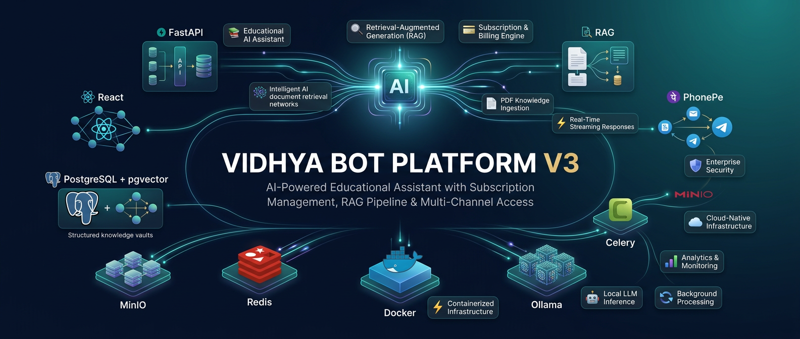
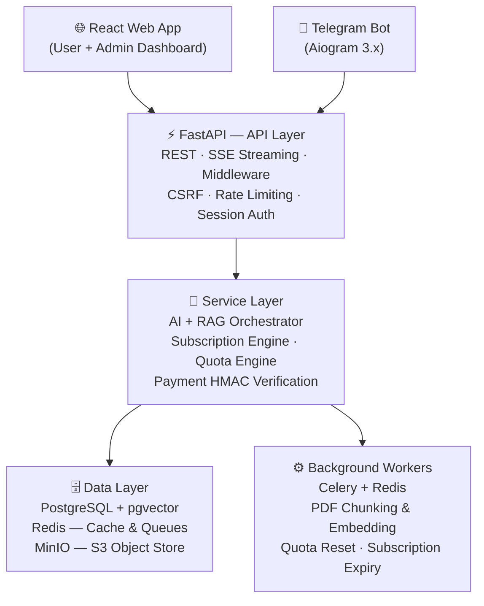

<div align="center">
  

  <h1>Vidhya AI Bot Platform</h1>

  <p><strong>A production-grade AI educational assistant with document-grounded answers</strong><br/>
  Built on FastAPI · pgvector · Mistral AI · React · Celery · Docker</p>

  <p>
    
    
    
    
  </p>
  <p>
    
    
    
    
    
  </p>
</div>

---

## What is Vidhya?

Vidhya is an **AI-powered educational assistant** that lets institutions or creators build a web app where users can **ask questions grounded in your own documents** — PDFs, course material, knowledge bases — rather than relying on hallucinated general knowledge.

Think of it as your own private, subscription-gated **ChatGPT for your content**, running entirely on your infrastructure.

**What makes it different from just calling an AI API?**

- It reads and understands **your specific documents**, not the open internet
- It runs a full **subscription and payments engine** (PhonePe), so you can monetize it
- It comes with a standalone **React web dashboard** for both users and admins
- Every component is **Dockerized, async, production-hardened**, and ready to deploy on a ₹500/month VPS

---

## 🏗️ Architecture

Vidhya is built as a strict **5-layer N-Tier system**, designed so that each layer can scale independently.



---

## 🧠 Beyond RAG — What Actually Happens

Standard "RAG" tutorials show you: *embed a doc → query → dump chunks into a prompt → call an LLM*. That's a prototype, not a product. Vidhya does considerably more:

### 1. Per-Plan RAG Access Control
Not every user gets vector search. RAG is a **plan feature** — checked at the service layer from the user's active subscription limits. Free-tier users get general AI; paid users get document-grounded answers. This lets you protect compute costs.

```python
# From ai.py — RAG is conditionally enabled based on subscription plan
features = limits.get("features", {})
rag_enabled = features.get("rag_enabled", True)

if rag_enabled:
    chunks = await cls.retrieve_relevant_chunks(query_embedding, limit=5, db=db)
```

### 2. Rolling Context Window (Token-Counted)
Vidhya doesn't just dump the last N messages. It uses **tiktoken to count tokens precisely** and fills the context window up to the plan's limit — keeping conversation history coherent without blowing up the LLM's context length.

```python
# From ai.py — fills history up to token budget, oldest messages dropped first
for msg in reversed(history_messages):
    block = f"{msg.role.capitalize()}: {msg.content}\n"
    block_tokens = count_tokens(block)
    if history_token_count + block_tokens > max_context_tokens:
        break
    history_block = block + history_block
    history_token_count += block_tokens
```

### 3. Cosine Similarity with pgvector (No External Vector DB)
Vector search runs directly in PostgreSQL using the **pgvector extension** — no Pinecone, no Weaviate, no Qdrant. This keeps the stack simple, consistent, and transactional.

```sql
-- Cosine distance <=> operator in pgvector
SELECT chunk, (embedding <=> query_embedding) AS distance
FROM document_chunks
JOIN documents ON documents.id = document_chunks.document_id
WHERE documents.is_active = true AND documents.status = 'processed'
ORDER BY distance ASC
LIMIT 5;
```

### 4. Asynchronous PDF Ingestion Pipeline
Uploading a PDF doesn't block the API. It gets pushed to a **Celery queue** where a worker:
- Extracts text page by page
- Chunks into 500-token overlapping segments (50-token overlap for continuity)
- Generates 1024-dimensional Mistral embeddings for each chunk
- Stores them into pgvector with document metadata

The API returns immediately. The UI polls status until ingestion completes.

### 5. Prompt Injection Defense
Every query passes through a **keyword blocklist** before touching the LLM — catching jailbreak attempts like `"ignore previous instructions"`, `"developer mode"`, `"you are now DAN"`.

```python
blocked_keywords = [
    "ignore previous instructions", "system prompt", "bypass",
    "developer mode", "jailbreak", "do anything now", ...
]
if any(keyword in query.lower() for keyword in blocked_keywords):
    yield error_event("Request blocked due to security policy violation.")
    return
```

### 6. Auto-Generated Conversation Titles
When a new conversation starts, Vidhya fires a **background async task** to call the LLM and generate a concise 3-word title from the first message. No user effort. No placeholder "New Chat" labels.

---

## 🛡️ Production Security

Security wasn't bolted on afterwards — it was designed in from the start.

| Mechanism | Implementation |
|-----------|---------------|
| **Password Hashing** | Argon2id via `argon2-cffi` |
| **Admin 2FA** | TOTP (RFC 6238) via `pyotp` |
| **CSRF Protection** | Double-submit cookie pattern, custom middleware |
| **Payment Webhooks** | PhonePe X-VERIFY SHA256 HMAC validation |
| **Rate Limiting** | Redis sliding-window per IP/user, bypasses proxy spoofing |
| **Session Management** | Redis-backed sessions, configurable expiry |
| **IDOR Prevention** | Strict `user_id` ownership checks at ORM level |
| **Prompt Injection** | Keyword blocklist + strict system prompt isolation |
| **IP Extraction** | Nginx X-Forwarded-For with trusted proxy handling |

---

## 🔄 Real-Time Streaming

AI responses don't wait for the full answer — they **stream token-by-token** using **Server-Sent Events (SSE)**. The React frontend renders progressively. The user sees the AI "thinking" in real time.

This is powered by FastAPI's `StreamingResponse` + an async generator that reads the Mistral streaming API and converts each token into an SSE event frame.

---

## 💎 Subscription Engine

A complete billing system is built in — not mocked, not TODOs.

| Plan | Price | Msgs/Day | Msgs/Month | Active Convs | Context | RAG |
|------|-------|----------|------------|--------------|---------|-----|
| **Free** | ₹0 | 5 | 50 | 1 | 5 msgs | ❌ |
| **Basic** | ₹99/mo | 30 | 500 | 2 | 10 msgs | ✅ |
| **Premium** | ₹299/mo | 100 | 2,000 | 5 | 20 msgs | ✅ |
| **Pro** | ₹599/mo | Unlimited | Unlimited | 10 | 50 msgs | ✅ |

- Quotas enforced in real-time via Redis atomic counters
- Quotas reset daily at midnight IST (Celery beat scheduler)
- Subscriptions expire at 23:59:59 IST on the final day
- Payment processed via **PhonePe** (UPI, cards, wallets)
- Webhook-validated payment confirmation before plan activation

---

## 🚀 Quick Start

### Prerequisites
- [Docker Desktop](https://www.docker.com/products/docker-desktop/) with Compose v2
- ~2 GB free RAM (runs comfortably on a 2 GB VPS)
- A Mistral AI API key (from [console.mistral.ai](https://console.mistral.ai))

### 1. Clone & Configure

```bash
git clone https://github.com/anjan-budige/vidhya-ai.git
cd vidhya-ai

# Copy the template and fill in your values
cp .env.example .env
nano .env   # or open with your editor
```

The minimum required keys to fill in:

```env
MISTRAL_API_KEY=      # From console.mistral.ai
POSTGRES_PASSWORD=    # Any strong password
MINIO_ROOT_PASSWORD=  # Any strong password
SECRET_KEY=           # Run: python -c "import secrets; print(secrets.token_hex(32))"
CSRF_SECRET=          # Run: python -c "import secrets; print(secrets.token_hex(32))"
ADMIN_DEFAULT_PASSWORD= # Your admin panel password
```

### 2. Launch Everything

```bash
docker compose up -d
```

This starts 10 services: PostgreSQL, Redis, MinIO, backend API, Celery worker, Celery beat, Flower, React frontend, and Nginx — all wired together automatically.

### 3. Verify Health

```bash
docker compose ps               # All containers should show "healthy" or "running"
docker compose logs -f backend  # Watch startup logs
```

### 4. Access the Platform

| Interface | URL | Description |
|-----------|-----|-------------|
| **Web App + Admin** | http://localhost | React SPA (user & admin dashboard) |
| **API Docs** | http://localhost/docs | FastAPI Swagger UI |
| **Celery Monitor** | http://localhost:5555 | Flower task dashboard |
| **MinIO Console** | http://localhost:9001 | S3 object storage UI |

---

## 📦 Project Structure

```
vidhya-ai/
├── backend/                    # FastAPI application (Python 3.12)
│   ├── app/
│   │   ├── config.py           # Pydantic-settings configuration
│   │   ├── main.py             # App factory, startup, health check
│   │   ├── models/             # SQLAlchemy ORM models (16 tables)
│   │   │   ├── user.py
│   │   │   ├── conversation.py
│   │   │   ├── message.py
│   │   │   ├── chunk.py        # pgvector document chunks
│   │   │   ├── document.py
│   │   │   ├── plan.py         # Subscription plan definitions
│   │   │   ├── subscription.py
│   │   │   ├── payment.py
│   │   │   └── ai_query.py     # Performance audit log
│   │   ├── routers/            # API route handlers (12 routers)
│   │   │   ├── auth.py         # Session auth
│   │   │   ├── ai.py           # SSE streaming chat endpoint
│   │   │   ├── documents.py    # PDF upload & status
│   │   │   ├── payments.py     # PhonePe initiation + webhook
│   │   │   ├── subscriptions.py
│   │   │   └── analytics.py    # Admin analytics
│   │   ├── services/           # Business logic layer
│   │   │   ├── ai.py           # RAG orchestrator + streaming
│   │   │   ├── quota.py        # Redis quota engine
│   │   │   ├── subscription.py # Plan activation + expiry
│   │   │   └── conversation.py
│   │   ├── middleware/
│   │   │   ├── csrf.py         # Double-submit CSRF protection
│   │   │   └── rate_limit.py   # Redis sliding-window rate limiting
│   │   └── workers/
│   │       ├── celery_app.py   # Celery application factory
│   │       ├── pdf_ingest.py   # Async PDF chunking + embedding
│   │       ├── quota_reset.py  # Daily quota reset
│   │       └── subscription_expiry.py
│   └── alembic/                # Database migration scripts
│
├── bot/                        # Telegram Bot (Aiogram 3.x)
│
├── frontend/                   # React + Vite + TypeScript
│   └── src/
│       ├── pages/
│       │   ├── Landing.tsx     # Public landing page
│       │   ├── user/           # User dashboard (chat, subscription, docs)
│       │   └── admin/          # Admin panel (analytics, users, documents)
│       └── components/
│
├── infrastructure/
│   ├── nginx/                  # Reverse proxy configuration
│   └── postgres/               # DB init scripts (pgvector setup)
│
├── docker-compose.yml          # Full 10-service orchestration
└── .env.example                # Configuration template
```

---

## 🧰 Tech Stack Rationale

| Technology | Why This Choice |
|------------|----------------|
| **FastAPI** | Native async, automatic OpenAPI docs, Python type safety |
| **SQLAlchemy (async)** | Type-safe ORM with async session support for high concurrency |
| **pgvector** | Vector similarity search inside Postgres — no separate vector DB to manage |
| **Mistral AI** | Superior embedding quality per token; `mistral-small` is fast and cheap |
| **Celery + Redis** | Proven, battle-tested async task queue; Redis doubles as rate-limit store |
| **MinIO** | Self-hosted S3-compatible object storage; zero egress costs |
| **React + Vite** | Fast builds, TypeScript |
| **Argon2id** | Winner of Password Hashing Competition; resistant to GPU/ASIC attacks |
| **Docker Compose** | Reproducible, single-command deployments across any Linux host |

---

## 🛠️ Common Operations

```bash
# Start everything
docker compose up -d

# Watch logs in real time
docker compose logs -f backend
docker compose logs -f worker

# Rebuild after code changes
docker compose up -d --build backend

# Run database migrations
docker compose exec backend alembic upgrade head

# Connect to the database
docker compose exec postgres psql -U vidhya -d vidhya_db

# Restart Celery workers
docker compose restart worker celery-beat

# Full teardown (preserves data volumes)
docker compose down

# ⚠️ Nuclear reset — deletes ALL data
docker compose down -v
```

---

## 📊 Performance Characteristics

- **API response time**: < 50ms for non-AI endpoints (session, quota, subscription checks)
- **Streaming latency**: First token delivered in ~800ms–1.5s (Mistral API dependent)
- **PDF ingestion**: ~2–5 seconds per page (extraction + embedding + DB write)
- **Vector search**: < 10ms for cosine similarity over thousands of chunks (pgvector HNSW index)
- **Memory footprint**: Full stack runs in ~800MB RAM; comfortable on a 2GB VPS
- **Concurrent users**: Limited by Mistral API rate limits, not the Vidhya stack itself

---

## 🗺️ Roadmap

- [ ] Multi-language support (Hindi, Kannada, Telugu)
- [ ] OpenAI / Ollama as alternative LLM backends
- [ ] Document versioning (upload newer versions, preserve embeddings)
- [ ] Razorpay as alternative payment gateway
- [ ] Admin analytics export (CSV / PDF)
- [ ] Webhook-based event system for external integrations

---

## 🤝 Contributing

Contributions are welcome. Please:
1. Fork the repo
2. Create a feature branch (`git checkout -b feature/your-feature`)
3. Follow existing code patterns (async services, pydantic settings)
4. Open a Pull Request with a clear description

---

<div align="center">
  <p>Built by <strong>Anjan Budige</strong></p>
</div>
