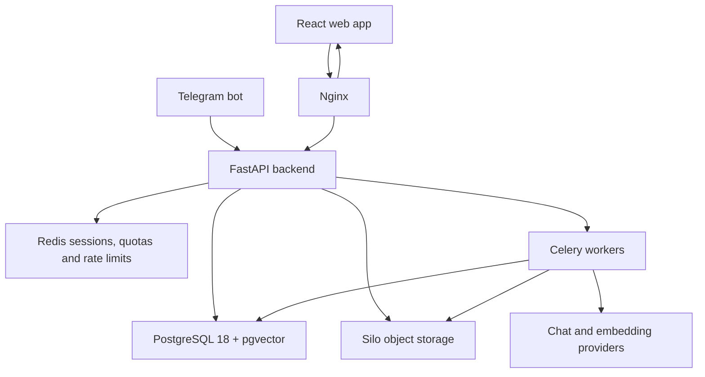

<div align="center">
  

  <h1>Vidhya AI</h1>

  <p><strong>A self-hosted AI knowledge system for every industry</strong><br/>
  Source-grounded answers from an organisation's own documents, with web, Telegram and admin access.</p>

  <p>
    
    
    
    
  </p>
  <p>
    
    
    
    
  </p>
</div>

## Overview

Vidhya AI turns an organisation's documents into a private answer system. Administrators publish source material once; users ask questions in a focused web workspace or through Telegram and receive answers grounded in that material.

The system is not tied to a single industry. The same platform can serve education, manufacturing, healthcare, legal, support, public-sector or internal corporate knowledge.

Core capabilities:

- Source-grounded retrieval through PostgreSQL and pgvector
- Separate chat and embedding model configuration
- Multiple AI providers, including custom OpenAI-compatible endpoints
- Streaming web chat with saved conversations and citations
- Telegram access linked to the same user account
- Owner-defined subscription models, or completely free access
- Five Indian payment gateways in demo, sandbox and production modes
- Role-based administration, usage analytics and an audit trail
- Fully containerised deployment on a local machine, VPS or private cloud

## Architecture



## Answer pipeline

1. An administrator uploads a PDF from the admin console.
2. The file is stored in Silo and a Celery job extracts its pages.
3. Text is split into overlapping chunks and sent to the active embedding model.
4. Vectors and source metadata are stored in pgvector.
5. A user question is embedded with the same active model.
6. Relevant chunks are retrieved within the subscription tier's context budget.
7. Recent conversation history and the stored older summary are added.
8. The selected chat model streams an answer over SSE.
9. Messages, sources, token usage and quota counters are persisted.

Changing the active embedding model triggers re-indexing. Documents embedded by an older model are not used for retrieval until they finish re-indexing.

## Application surfaces

| Surface | Purpose |
|---|---|
| Public landing page | Product overview and entry points |
| User workspace | Streaming chat, saved chats, subscription, Telegram key and profile |
| Admin console | Knowledge base, AI providers, users, subscriptions, payments, analytics, audit and system status |
| Telegram bot | Account linking and knowledge chat through the same backend |
| Payment pages | Provider checkout and payment result pages |

## Access and security

- Passwords are hashed with Argon2id.
- Web sessions are opaque, stored in Redis and delivered through HttpOnly cookies.
- CSRF is enforced with a signed double-submit cookie.
- Administrators can protect sign-in with TOTP.
- Every sensitive state-changing browser request is checked server-side.
- User API keys are SHA-256 hashed and shown only once.
- API keys work only through the Telegram bot bridge, not raw browser or curl access.
- Payment and AI provider credentials are encrypted at rest.
- Webhooks are signature-verified, amount-checked and idempotent.
- Rate limits are applied per account and trusted client address.
- Only Nginx is publicly exposed; internal services bind to localhost or the private Docker network.

For production, serve the platform over HTTPS and enable secure session cookies.

## Subscription model

The platform owner defines the commercial model from the admin console:

- Subscription price and access duration
- Daily and monthly message allowances
- Maximum saved conversations
- Input context and response token ceilings
- Model availability and document-grounding capability

Billing can be switched off completely. In free mode, every account uses the free tier's allowances and checkout is disabled by the server.

Supported gateways: **Razorpay, Cashfree, Paytm, PhonePe and PayU**, plus a local demo provider. Only one provider can be active per checkout environment.

## Tech stack

| Layer | Technology |
|---|---|
| Frontend | React 19, TypeScript, Vite 8, Tailwind CSS 4, React Router 7 |
| UI and motion | Lucide, Recharts, anime.js, React Markdown, KaTeX |
| Backend | Python 3.12, FastAPI 0.162, Starlette 1.10, Uvicorn |
| ORM and validation | SQLAlchemy 2 async, asyncpg, Pydantic 2 |
| Database | PostgreSQL 18 with pgvector 0.8.7 |
| Cache and queues | Redis 8.6 and Celery 5.4 |
| Object storage | Silo S3-compatible storage |
| Telegram | aiogram 3.31 |
| Email | Resend |
| Reverse proxy | Nginx 1.31 Alpine |
| Deployment | Docker Compose |

## Getting started

### Requirements

- Docker Desktop or Docker Engine with Compose v2
- A configured AI provider, added later from the admin console
- A Resend account for transactional email
- A Telegram bot token if Telegram access is required

### Configuration

```bash
cp .env.example .env
```

Fill in the required database, storage, encryption, session and admin values. Provider credentials are not stored in `.env`; they are entered in the admin console and encrypted in the database.

### Start the platform

```bash
docker compose up -d --build
docker compose ps
```

Open:

- Web application: `http://localhost`
- Admin console: `http://localhost/admin/login`
- Flower: `http://localhost:5555`
- Silo console: `http://localhost:9001`

## Service map

| Service | Responsibility |
|---|---|
| `nginx` | Public reverse proxy, security headers and rate limits |
| `frontend` | Static React build served by Nginx |
| `backend` | REST API, SSE streaming, authentication, admin APIs and webhooks |
| `postgres` | Relational data and vector embeddings |
| `redis` | Sessions, quotas, auth cache and Celery broker |
| `silo` | Private object storage for uploaded documents |
| `silo-init` | One-time bucket creation and private policy setup |
| `bot` | Telegram polling and account-linked chat |
| `worker` | PDF ingestion, embeddings, summaries, quota and analytics jobs |
| `celery-beat` | Scheduled quota resets, subscription expiry and maintenance |
| `flower` | Celery monitoring |

## Project layout

```text
vidhya-ai/
├── backend/
│   ├── app/
│   │   ├── models/          # SQLAlchemy models
│   │   ├── routers/         # FastAPI routes
│   │   ├── services/        # AI, auth, quota, payments, platform logic
│   │   ├── middleware/      # CSRF and rate limiting
│   │   ├── workers/         # Celery jobs
│   │   └── utils/           # Crypto, email and internal authentication
│   ├── requirements.txt
│   └── Dockerfile
├── bot/                     # aiogram Telegram bot
├── frontend/
│   ├── src/
│   │   ├── pages/           # Landing, user and admin screens
│   │   ├── components/      # Layouts and shared UI
│   │   ├── contexts/        # User state
│   │   └── lib/             # API and formatting helpers
│   └── Dockerfile
├── infrastructure/
│   ├── nginx/               # Reverse proxy and security policies
│   └── postgres/            # Schema and database image
├── docker-compose.yml
└── .env.example
```

## Operations

```bash
docker compose logs -f backend
docker compose logs -f worker
docker compose restart backend bot
docker compose up -d --build
docker compose down
```

Database schema changes are applied through `infrastructure/postgres/init.sql`.

---

<div align="center">
  <p>Built and maintained by <strong>Anjan Budige</strong>.</p>
  <p>Copyright © 2026 Anjan Budige. All rights reserved.</p>
</div>
